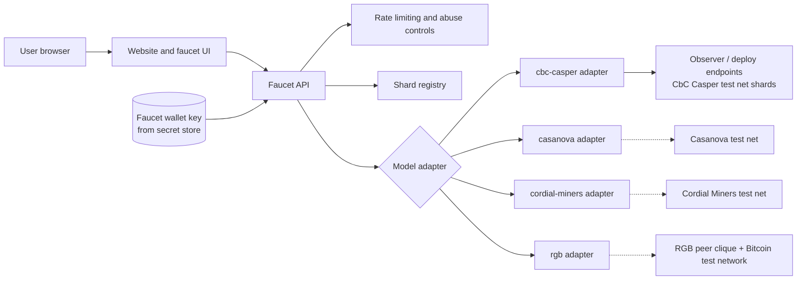

# F1r3Faucet

A general-purpose faucet and website for [F1r3fly](https://github.com/F1R3FLY-io) shards.

F1r3fly separates execution (Rholang on the RSpace tuple space) from ordering. Each test net runs exactly one consensus or state machine replication (SMR) model. F1r3Faucet serves all of them through one site, with one adapter per model.

> **Status:** Early stage. This README describes the intent and the planned stack. No code exists yet.

## Purpose

- **Faucet:** Developers and partners request test tokens for an address on a chosen test net shard. Rate limits and abuse controls apply.
- **Website:** The site lists the available test nets and shards, their consensus model, network status, and connection details (gRPC and HTTP endpoints of the read-only observers).
- **Model-neutral:** One codebase covers every consensus model. Each model plugs in through an adapter instead of a fork.

## Context: the F1r3fly test nets

Test net work is tracked in **EPIC-014: F1r3fly CbC Casper Test Net (Continuously Running Shards)** in [`f1r3node-rust/docs/ToDos.md`](https://github.com/F1R3FLY-io/f1r3node-rust/blob/dev/docs/ToDos.md). The design record is [`docs/plans/test-net.md`](https://github.com/F1R3FLY-io/f1r3node-rust/blob/dev/docs/plans/test-net.md).

Points from that work that shape this repository:

- **One model per test net.** A test net never mixes consensus models, even across shards. Each model has its own network, keys, metrics store, and design record.
- **Several shards per test net.** A release that cannot interoperate with its shard starts a new shard with a fresh genesis. Old shards run until a retirement policy removes them. The faucet must therefore discover shards and must not hard-code them.
- **Partner access is read-only on the observer.** The first partner access is the gRPC and HTTP API of the observer on the main shard. Partners never reach a validator. The faucet runs its own funded wallet and submits deploys through the endpoints that operators expose to it.
- **Secrets stay out of the repository.** Validator keys live in OCI Vault. The faucet wallet key follows the same rule.

### Consensus model registry

The registry follows `test-net.md` Section 12.1. The faucet adds support for a model when that model has a running test net.

| Model | `consensus_model` | Ordering medium | Test net state | Faucet support |
|---|---|---|---|---|
| CbC Casper | `cbc-casper` | Multi-parent PoS block DAG | EPIC-014, in progress | First target |
| Casanova | `casanova` | Leaderless optimistic PoS block DAG | Not designed | Planned |
| Cordial Miners | `cordial-miners` | Blocklace (partial order, then τ total order) | Not designed | Planned |
| RGB | `rgb` | Peer-clique sidecar anchored to Bitcoin single-use seals and Lightning | Not designed | Planned; needs a different flow (client-side validation) |

## Architecture (proposed)



Each model adapter implements one interface:

- `getShards()`: list the live shards of the test net and their endpoints
- `getStatus(shard)`: the health, height or order progress, and the finalized state
- `validateAddress(address)`: check the address format of the model
- `getBalance(shard, address)`: read a balance
- `fund(shard, address, amount)`: submit the transfer and return a receipt that the UI can track

## Tech stack

- **Language:** TypeScript (strict mode)
- **Styling:** Tailwind CSS
- **Runtime:** Node.js 24 LTS
- **Package manager, framework, and test runner:** To be decided when the project is scaffolded

## Getting started

Scaffolding is not in place yet. When it is, this section will cover:

```bash
# install dependencies
# run the development server
# run tests and lint
```

Configuration comes from environment variables, for example the shard registry source, the faucet wallet key reference, and the rate limits. A `.env.example` file will list them. Real keys are never committed.

## Roadmap

1. Scaffold the TypeScript and Tailwind CSS project, with lint, format, and test setup.
2. Build the website shell: the test net and shard list, the status pages, and the connection details.
3. Implement the `cbc-casper` adapter and the faucet flow against a local shard, then against the CbC Casper test net once EPIC-014 opens it.
4. Add rate limiting, abuse controls, and faucet wallet balance alerts.
5. Add an adapter for each further model when its test net exists (Casanova, Cordial Miners, RGB).

## Contributing

This repository uses the F1R3FLY.io workspace conventions: stigmergic task tracking in `docs/ToDos.md`, work logs in `docs/work-logs/`, and design docs in `docs/designs/` before implementation. Do not commit keys, personal data, or absolute paths.

## License

To be decided.
