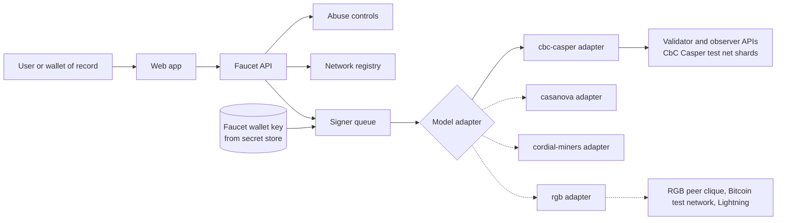

# F1r3Faucet

A general-purpose faucet and website for [F1r3fly](https://github.com/F1R3FLY-io) shards.

F1r3fly separates execution (Rholang on the RSpace tuple space) from ordering. Each test net runs exactly one consensus or state machine replication (SMR) model. F1r3Faucet serves all of them through one site, with one adapter per model.

> **Status:** Early stage. This README describes the intent and the planned stack. No code exists yet.

## Purpose

- **Faucet:** Anyone who tests F1r3fly shards requests test tokens for an address on a chosen test net shard. Rate limits and abuse controls apply.
- **Website:** The site lists the available test nets and shards, their consensus model, network status, and connection details (gRPC and HTTP endpoints of the read-only observers).
- **Model-neutral:** One codebase covers every consensus model. Each model plugs in through an adapter instead of a fork.

## Reference implementation

F1r3Faucet follows the ASI Chain faucet, because F1r3fly is the base layer of ASI Chain. It keeps the ASI flow (sign a system vault transfer on the server, send it to a validator, track it to finality) and adds support for more than one network, more than one consensus model, and the wallets of record. It also closes gaps in the ASI faucet, for example a balance ceiling that never stops a claim and no rate limit. Section 2 of the [architecture record](docs/designs/faucet-architecture.md) gives the full review.

[git@github.com:asi-alliance/asi-chain-faucet.git](https://github.com/asi-alliance/asi-chain-faucet)

## Wallets of record

The F1r3fly projects have three wallets of record. All three show the same vault address (`1111...`), derived from a secp256k1 public key. The faucet accepts that address, an ETH address, or a public key, and gives each wallet a prefill link.

| Wallet | Faucet support | Release |
|--------|----------------|---------|
| [f1r3wallet](https://github.com/F1R3FLY-io/f1r3wallet) | Address forms and prefill link | v0.3.0 |
| [ASI Chain wallet](https://github.com/asi-alliance/asi-chain-wallet) | Address forms and prefill link | v0.3.0 |
| [SATCHEL](https://gitlab.com/smart-assets.io/satchel/rgb-satchel) | Public key input, wallet link, ownership proof on the RGB test net | v0.5.0 |

SATCHEL deploys on the RGB test net first, and that test net needs the consensus and SMR boundary of f1r3node-rust EPIC-025. Section 3.1 of the [architecture record](docs/designs/faucet-architecture.md) gives the details.

## Context: the F1r3fly test nets

**EPIC-014** in f1r3node-rust tracks the CbC Casper test net. Its design record is `docs/plans/test-net.md` on the `ci/testnet-deployment` branch. **EPIC-025** (PR #627) tracks the boundary between node services and each consensus model. The records below pin both design documents at the commits that this plan used.

[git@github.com:F1R3FLY-io/f1r3node-rust.git](https://github.com/F1R3FLY-io/f1r3node-rust)

```yaml cross-reference
reference:
  purpose: evidence
  repository: https://github.com/F1R3FLY-io/f1r3node-rust
  checkout: ../f1r3node-rust
  revision: 19bed60a334f86caa32e38ab4c10ce73b7b12287
  path: docs/plans/test-net.md
  url: https://github.com/F1R3FLY-io/f1r3node-rust/blob/19bed60a334f86caa32e38ab4c10ce73b7b12287/docs/plans/test-net.md
```

```yaml cross-reference
reference:
  purpose: evidence
  repository: https://github.com/F1R3FLY-io/f1r3node-rust
  checkout: ../f1r3node-rust
  revision: 6609305bbde5a13ab6df4d1f0877bfbe53e74f2a
  path: docs/designs/replication-boundary.md
  url: https://github.com/F1R3FLY-io/f1r3node-rust/blob/6609305bbde5a13ab6df4d1f0877bfbe53e74f2a/docs/designs/replication-boundary.md
```

Points from that work that shape this repository:

- **One model per test net.** A test net never mixes consensus models, even across shards. Each model has its own network, keys, metrics store, and design record.
- **Several shards per test net.** A release that cannot interoperate with its shard starts a new shard with a fresh genesis. Old shards run until a retirement policy removes them. The faucet must therefore discover shards and must not hard-code them.
- **Partner access is read-only on the observer.** The first partner access is the gRPC and HTTP API of the observer on the main shard. Partners never reach a validator. The faucet runs its own funded wallet and submits deploys through the endpoints that operators expose to it.
- **Secrets stay out of the repository.** Validator keys live in OCI Vault. The faucet wallet key follows the same rule.

### Consensus model registry

The registry follows `test-net.md` Section 12.1. The faucet adds support for a model when that model has a running test net.

| Model | `consensus_model` | Ordering medium | Test net state | Faucet support |
|---|---|---|---|---|
| CbC Casper | `cbc-casper` | Multi-parent PoS block DAG | EPIC-014, in progress | First target |
| Casanova | `casanova` | Leaderless optimistic PoS block DAG | Not designed | Planned |
| Cordial Miners | `cordial-miners` | Blocklace (partial order, then τ total order) | Not designed | Planned |
| RGB | `rgb` | Peer-clique sidecar anchored to Bitcoin single-use seals and Lightning | Not designed | Planned. Needs a different flow (client-side validation) |

## Architecture (proposed)



Each model adapter implements one interface: `capabilities`, `networkInfo`, `progress`, `balance`, `submitTransfer`, and `status`. Only an adapter may contain logic that is specific to one model. Section 5 of the [architecture record](docs/designs/faucet-architecture.md) defines the interface, the network registry, the claim lifecycle, and the signer queue.

## Tech stack

- **Language:** TypeScript (strict mode)
- **Styling:** Tailwind CSS
- **Runtime:** Node.js 24 LTS
- **Web:** Vite, React, and Tailwind CSS
- **API:** Fastify
- **Workspace and tests:** pnpm, Vitest, and Playwright
- **Signing:** deploy signing in TypeScript
- **Hosting:** OCI beside the test net

The [stack and hosting record](docs/designs/stack-and-hosting.md) gives the reasons (accepted 2026-10-15)

## Getting started

Scaffolding is not in place yet. When it is, this section will cover:

```bash
# install dependencies
# run the development server
# run tests and lint
```

Configuration comes from environment variables, for example the shard registry source, the faucet wallet key reference, and the rate limits. A `.env.example` file will list them. Real keys are never committed.

## Roadmap

| Release | Theme | Target |
|---------|-------|--------|
| v0.1.0 | Local CbC Casper faucet: client package, adapters, API | 2026-Q4 |
| v0.2.0 | Website, abuse controls, and operations | 2027-Q1 |
| v0.3.0 | CbC Casper test net launch on OCI, partner tier, and wallet links | 2027-Q1 |
| v0.4.0 | Other consensus models, including RGB | 2027-Q2 |
| v0.5.0 | SATCHEL on the RGB test net | 2027-Q3 |

- [Roadmap](docs/roadmap.md): releases, gates, and sequence
- [Tasks and epics](docs/ToDos.md): EPIC-001 to EPIC-010
- [User stories](docs/UserStories.md)
- [Architecture record and open questions](docs/designs/faucet-architecture.md)
- [Stack and hosting record](docs/designs/stack-and-hosting.md)
- [Node compatibility proposal](docs/designs/node-compatibility.md)

## Contributing

This repository uses the F1R3FLY.io workspace conventions: stigmergic task tracking in `docs/ToDos.md`, work logs in `docs/work-logs/`, and design docs in `docs/designs/` before implementation. Do not commit keys, personal data, or absolute paths.

## License

To be decided.
