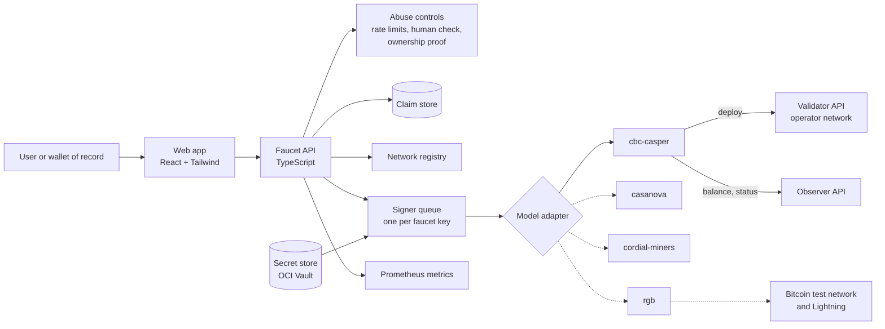
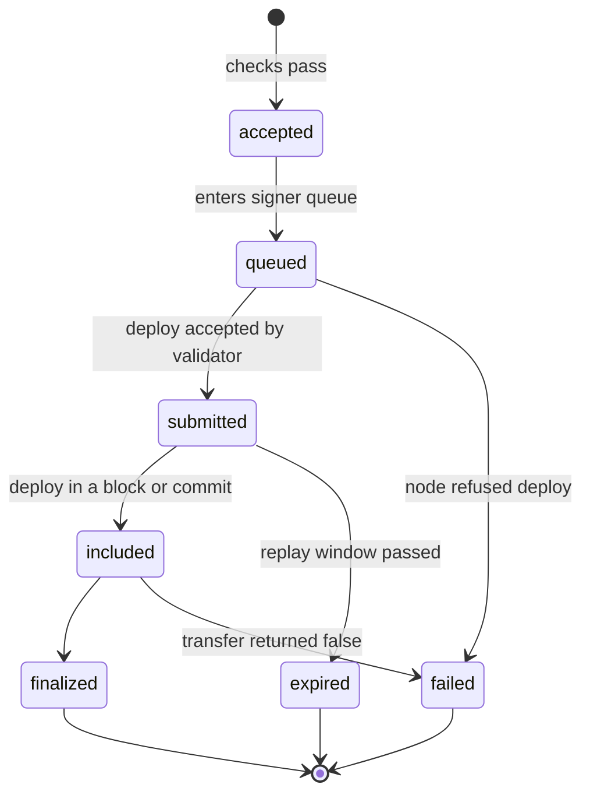

# F1r3Faucet Architecture

This record proposes the architecture of F1r3Faucet. It uses the ASI Chain faucet as the reference implementation, because F1r3fly is the base layer of ASI Chain. It then adds the two parts that are specific to F1r3fly: the wallets of record, and more than one consensus model.

Status: **proposed**. Section 9 lists the questions for the maintainers and the answers received.

## 1. Sources

| Source | Revision | Purpose |
|--------|----------|---------|
| ASI Chain faucet (`asi-alliance/asi-chain-faucet`) | `main` at `2b333b4` | Reference implementation |
| f1r3node-rust PR #627, Pluggable State Machine Replication Boundary | PR head `6609305` | Consensus model boundary (EPIC-025) |
| f1r3node-rust test net design | `ci/testnet-deployment` at `19bed60` | Test net topology, access, and security (EPIC-014) |
| f1r3node-rust node API and SystemVault contract | `dev` at `1b61300` | Deploy, finality, and balance interfaces |
| SATCHEL repositories (`smart-assets.io/satchel`) | `dev`, and rgb-satchel `master` at `3dc2ac1` | Wallet key model and the current regtest faucets |
| f1r3wallet and ASI Chain wallet | `main` at `881d759` and `750b199` | Key, address, and vault URI of the other wallets of record. The [stack record](stack-and-hosting.md) cites their signing code |

The frontmatter records the main sources. The records below give the specific files.

ASI Chain faucet, reviewed at a fixed commit:

[git@github.com:asi-alliance/asi-chain-faucet.git](https://github.com/asi-alliance/asi-chain-faucet)

```yaml cross-reference
reference:
  purpose: evidence
  repository: https://github.com/asi-alliance/asi-chain-faucet
  checkout: ../../../../ASI-chain/asi-chain-faucet
  revision: 2b333b4066a571aa1f3c91d67173f9f02aa0f779
  path: server/src/api/handlers/transfer.rs
  url: https://github.com/asi-alliance/asi-chain-faucet/blob/2b333b4066a571aa1f3c91d67173f9f02aa0f779/server/src/api/handlers/transfer.rs
```

Node API routes, the SystemVault contract, and the vault address format:

[git@github.com:F1R3FLY-io/f1r3node-rust.git](https://github.com/F1R3FLY-io/f1r3node-rust)

```yaml cross-reference
reference:
  purpose: evidence
  repository: https://github.com/F1R3FLY-io/f1r3node-rust
  checkout: ../../../f1r3node-rust
  revision: 1b61300cab891e6e898a9b8423cedfd4c23c2ae8
  path: node/src/rust/web/web_api_routes.rs
  url: https://github.com/F1R3FLY-io/f1r3node-rust/blob/1b61300cab891e6e898a9b8423cedfd4c23c2ae8/node/src/rust/web/web_api_routes.rs
```

```yaml cross-reference
reference:
  purpose: evidence
  repository: https://github.com/F1R3FLY-io/f1r3node-rust
  checkout: ../../../f1r3node-rust
  revision: 1b61300cab891e6e898a9b8423cedfd4c23c2ae8
  path: casper/src/main/resources/SystemVault.rho
  url: https://github.com/F1R3FLY-io/f1r3node-rust/blob/1b61300cab891e6e898a9b8423cedfd4c23c2ae8/casper/src/main/resources/SystemVault.rho
```

```yaml cross-reference
reference:
  purpose: evidence
  repository: https://github.com/F1R3FLY-io/f1r3node-rust
  checkout: ../../../f1r3node-rust
  revision: 1b61300cab891e6e898a9b8423cedfd4c23c2ae8
  path: rholang/src/rust/interpreter/util/vault_address.rs
  url: https://github.com/F1R3FLY-io/f1r3node-rust/blob/1b61300cab891e6e898a9b8423cedfd4c23c2ae8/rholang/src/rust/interpreter/util/vault_address.rs
```

SATCHEL key derivation and the current vault faucet:

[git@gitlab.com:smart-assets.io/satchel/rgb-satchel.git](https://gitlab.com/smart-assets.io/satchel/rgb-satchel)

```yaml cross-reference
reference:
  purpose: evidence
  repository: https://gitlab.com/smart-assets.io/satchel/rgb-satchel
  checkout: ../../../../SA/SATCHEL/rgb-satchel
  revision: 3dc2ac1c4c0d9bb00fbc5c0d1ceaec8127473541
  path: src/faucet/vault.rs
  url: https://gitlab.com/smart-assets.io/satchel/rgb-satchel/-/blob/3dc2ac1c4c0d9bb00fbc5c0d1ceaec8127473541/src/faucet/vault.rs
```

```yaml cross-reference
reference:
  purpose: evidence
  repository: https://gitlab.com/smart-assets.io/satchel/rgb-satchel
  checkout: ../../../../SA/SATCHEL/rgb-satchel
  revision: 3dc2ac1c4c0d9bb00fbc5c0d1ceaec8127473541
  path: src/storage/keys.rs
  url: https://gitlab.com/smart-assets.io/satchel/rgb-satchel/-/blob/3dc2ac1c4c0d9bb00fbc5c0d1ceaec8127473541/src/storage/keys.rs
```

SATCHEL security levels and the TypeScript API client:

[git@gitlab.com:smart-assets.io/satchel/satchelSmartWallet.git](https://gitlab.com/smart-assets.io/satchel/satchelSmartWallet)

```yaml cross-reference
reference:
  purpose: current
  repository: https://gitlab.com/smart-assets.io/satchel/satchelSmartWallet
  checkout: ../../../../SA/SATCHEL/SatchelSmartWallet
  revision: dev
  path: docs/UserSecurityModel.md
  url: https://gitlab.com/smart-assets.io/satchel/satchelSmartWallet/-/blob/dev/docs/UserSecurityModel.md
```

```yaml cross-reference
reference:
  purpose: current
  repository: https://gitlab.com/smart-assets.io/satchel/satchelSmartWallet
  checkout: ../../../../SA/SATCHEL/SatchelSmartWallet
  revision: dev
  path: packages/core/src/services/satchelApi.ts
  url: https://gitlab.com/smart-assets.io/satchel/satchelSmartWallet/-/blob/dev/packages/core/src/services/satchelApi.ts
```

## 2. Review of the ASI Chain faucet

The ASI Chain faucet has a Rust API (axum) and a React single-page application. The API signs a SystemVault transfer with one private key and sends it to a random validator through the F1r3fly `rust-client` library. The UI then polls the deploy status until the deploy is finalized.

### 2.1 What F1r3Faucet keeps

| ASI feature | Reason to keep it |
|-------------|-------------------|
| Separate web and API tiers | The signing key stays on the server |
| Transfer through the system vault (`findOrCreate`, `deployerAuthKey`, `transfer`) | This is the native transfer path on every F1r3fly shard |
| Deploy to a validator, read state from an observer | The node enforces this split (read-only nodes refuse deploys) |
| Return a deploy ID at once, then track status | A deploy takes one or more blocks to finalize |
| Status phases: deploying, finalizing, finalized, deploy error, finalization error | These phases are clear to users. F1r3Faucet adds `expired` |
| Recipient balance ceiling | This is a simple first control against abuse |
| Request ID middleware, body size limit, timeout layer | Good operational defaults |

### 2.2 What F1r3Faucet changes

| ASI gap (file at `2b333b4`) | F1r3Faucet decision | Epic |
|-----------------------------|---------------------|------|
| The balance ceiling multiplies a value that is already in dust by 10^8, so the check never stops a claim (`server/src/api/handlers/transfer.rs`) | Keep all amounts as `bigint` dust. Name each unit in the type. Test the ceiling at its boundary | EPIC-004 |
| No rate limit and no captcha on `/transfer`. CORS allows any origin (`server/src/api/router.rs`) | Rate limits by IP, address, and network. Human verification on each claim. CORS allowlist | EPIC-005 |
| `debug!` prints the configuration, including the private key (`server/src/main.rs`) | The signer is a separate module. The key never enters a loggable object | EPIC-004 |
| One network for each deployment. `shard_id` is fixed to `root` in the client library | A network registry with one entry for each test net and shard. The shard ID comes from the node `status` call | EPIC-003 |
| Address check is the `1111` prefix and a length only | Full vault address check: Base58 decode, coin ID, version, and the Blake2b-256 checksum | EPIC-002 |
| Concurrent claims sign with one key and are not put in sequence | A signer queue for each faucet key. Idempotency keys on claims | EPIC-004 |
| The server returns raw node error text to clients | Typed error codes. Node detail goes to logs only | EPIC-004 |
| No tests, no lint or build in CI, lockfiles are not committed | Strict TypeScript, unit and contract tests, CI for lint, type check, test, and build. Lockfile committed | EPIC-001 |
| No server health route, no metrics, no alert for a low faucet balance | Liveness and readiness routes, Prometheus metrics, and a balance alert | EPIC-008 |
| Frontend and backend disagree about token decimals | Token name, symbol, and decimals come from the node `status` call | EPIC-003 |

F1r3Faucet does not copy code from the ASI faucet. It uses the ASI faucet as a behavior reference only. Section 9, Q11, asks whether the team must report these gaps to the ASI maintainers.

## 3. Differences specific to F1r3fly

### 3.1 Wallets of record

The F1r3fly projects have three wallets of record (maintainer answer to Q1, 2026-10-15):

| Wallet | Role | Key model | Address shown | Vault URI in its code | Faucet hook today |
|--------|------|-----------|---------------|-----------------------|-------------------|
| SATCHEL | Main wallet, first on the RGB test net | BIP-39 mnemonic, F1r3fly key at `m/1337'/0'/0'/0/0` | Vault address (`1111...`) | Through `rust-client` | Regtest vault faucet on `master` only |
| f1r3wallet | Simple wallet ("dumb wallet"), a fork of `rnode-client-js` | Random secp256k1 key, or MetaMask and Ledger through `secp256k1:eth` | Vault address and ETH address | `rho:rchain:revVault` | None |
| ASI Chain wallet | ASI Alliance wallet | Random secp256k1 key, or Ledger and Trezor at `m/44'/60'/0'/0/i` | Vault address (labelled "ASI address") and ETH address | `rho:rchain:asiVault` | A "Faucet" link to a build-time URL, with no parameters |

Findings that affect the faucet:

- **One address format.** All three wallets show the same vault address, derived from a secp256k1 public key. The ASI Chain wallet has no Cosmos code, although the maintainer described it as centered on a Cosmos chain. Section 9, Q15, asks whether a Cosmos address is planned elsewhere.
- **ETH addresses.** f1r3wallet and the ASI Chain wallet also show an ETH address (`0x...`). A vault address is derived from the ETH address, so the faucet can accept both forms.
- **Vault URI mismatch.** f1r3node-rust `dev` registers only `rho:vault:system`. The Rholang in f1r3wallet (`rho:rchain:revVault`) and in the ASI Chain wallet (`rho:rchain:asiVault`) does not resolve on a current F1r3fly shard. The faucet uses the vault URI from the registry entry of each shard, with `rho:vault:system` as the default. Section 9, Q16, asks who tells the wallet maintainers.
- **Deep link.** No wallet sends an address or a network to a faucet today. F1r3Faucet defines a prefill URL (`?network=<id>&address=<address>`) that each wallet can add.

SATCHEL details:

- A SATCHEL is a hierarchical deterministic wallet, not a Rholang contract account. Its F1r3fly address is a standard vault address, so a deposit is an ordinary system vault transfer.
- SATCHEL deploys on the RGB test net first. That test net needs the consensus and SMR boundary of EPIC-025 in f1r3node-rust. SATCHEL integration therefore follows the RGB adapter (EPIC-010).
- The SATCHEL regtest vault faucet takes a bare public key and has no rate limit. When its environment variable is not set, it uses a private key from the source code.
- Optional ownership proof: the user signs a server challenge with the SATCHEL F1r3fly key, and a proven owner gets a higher limit. The SATCHEL server has no challenge-signing endpoint today (Q3).

### 3.2 Consensus models

PR #627 proposes one boundary between node services and a replication mechanism (`ReplicationMedium`). A shard binds one mechanism at start, and the binding never changes. Execution stays Rholang on RSpace for every mechanism. The deploy format, the signature, and the SystemVault contract are therefore the same for each model.

The parts that change from model to model:

| Concern | CbC Casper (today) | Casanova, Cordial Miners | RGB peer clique |
|---------|--------------------|--------------------------|-----------------|
| Submit a deploy | `POST /api/deploy` or gRPC `doDeploy` on a validator | Planned neutral deploy endpoint (TASK-025-5) | Planned neutral deploy endpoint. The model for client funds is not defined (PR #627 open question 1) |
| Finality | `deployFinalizationStatus`, `isFinalized` | `FinalityEvent` stream (planned) | Quorum certificate, then a Bitcoin or Lightning anchor |
| Progress | Block number | `CommitRecord.sequence` (Cordial Miners uses τ order) | Height of each transaction |
| Replay window | `validAfterBlockNumber` plus `deploy-lifespan` | Not defined | Not defined |
| Other assets to dispense | None | None | Test BTC, and possibly Lightning liquidity and RGB assets |

F1r3Faucet hides these differences behind one adapter interface (Section 5). The `cbc-casper` adapter uses the API that exists today. Each other adapter waits for the neutral endpoints of EPIC-025 or for a design record of its own model.

### 3.3 Token naming

Design question Q2 stays open for maintainer review. The node source on `dev` at `1b61300` shows these facts:

- Phlo is the fee unit (`phloLimit`, `phloPrice`, `min-phlo-price`).
- Each shard sets `native-token-name`, `native-token-symbol`, and `native-token-decimals` at genesis. The defaults are `F1R3CAP`, `F1R3`, and `8`. The values cannot change after genesis.
- The node status call and the `TokenMetadata` contract return these values.
- The smallest unit is dust (1 token = 10^decimals dust).
- REV and RevVault remain only in test comments and test names. The ASI client library uses ASI.

The faucet therefore reads the token name from each shard and hard-codes no name.

## 4. System context



Dashed lines show adapters that wait on other work.

The faucet runs on OCI beside the test net (maintainer answer to Q5). The test net design, Section 12.4, gives the faucet the only deploy path. Partners reach only the observer. Deploys do not gossip between nodes, so the faucet must send each deploy directly to a validator. Section 6 of the stack record explains the two choices that the test net operators must make. The [stack and hosting record](stack-and-hosting.md) gives the proposed OCI topology.

## 5. Components

### 5.1 Repository layout (proposed)

```text
apps/
  web/          React, Vite, Tailwind CSS
  api/          HTTP API, signer queue, claim store
packages/
  f1r3fly/      Vault address, deploy signing, node HTTP client
  adapters/     ConsensusAdapter interface and one adapter for each model
  registry/     Network registry schema and loader
  shared/       Types and error codes that the web app and the API share
```

The workspace uses one package manager and one lockfile. Q8 asks for the frontend and backend frameworks.

### 5.2 Adapter interface

The interface follows the neutral types of PR #627, so that later adapters fit without a change to the API service.

```ts
type Dust = bigint;

interface ConsensusAdapter {
  readonly model: "cbc-casper" | "casanova" | "cordial-miners" | "rgb";
  capabilities(): AdapterCapabilities;          // e.g. supportsBalance, assets[]
  networkInfo(): Promise<NetworkInfo>;          // shardId, token name/symbol/decimals, minPhloPrice
  progress(): Promise<Progress>;                // sequence | null, lastFinalizedId
  balance(address: VaultAddress): Promise<Dust>;
  submitTransfer(req: SignedTransfer): Promise<SubmissionId>;
  status(id: SubmissionId): Promise<ClaimStatus>; // pending | included | finalized | failed | expired
}
```

Only an adapter may contain logic that is specific to one model.

### 5.3 Network registry

The test net publishes the registry of its live shards (test net design, Section 12.4, item 2). F1r3Faucet reads that registry and adds its own settings (claim limits, key reference). A JSONC file in the repository serves local development. Each entry describes one shard:

```jsonc
{
  "id": "cbc-casper-main",
  "consensusModel": "cbc-casper",
  "displayName": "CbC Casper test net, main shard",
  "status": "active",            // active | retiring | retired
  "validatorApi": ["https://validator.example.test"],
  "observerApi": "https://observer.example.test",
  "faucetKeyRef": "oci-vault://faucet/cbc-casper-main",
  "vaultUri": "rho:vault:system", // optional, default rho:vault:system
  "claim": { "amountDust": "100000000", "ceilingDust": "500000000", "cooldownHours": 24 }
}
```

The shard ID and the token metadata are not in the file. The adapter reads them from the node `status` call at start, so the registry cannot disagree with the node.

### 5.4 Claim lifecycle



### 5.5 Signer queue

Each faucet key has one queue. The queue sends one deploy at a time for each key, so that concurrent claims cannot race. When a claim expires, the queue sends it again one time with a new `validAfterBlockNumber`. A claim has an idempotency key, so a retry from the browser does not create a second transfer.

### 5.6 Abuse controls

| Control | Default (proposed) |
|---------|--------------------|
| Audience | Anyone who tests F1r3fly shards. Partners and customers first (maintainer answer to Q13) |
| Recipient balance ceiling | 5 tokens, configured for each network |
| Cooldown for each address | 24 hours |
| Rate limit for each IP address | 3 claims each hour |
| Global limit for each network | Configured, with an alert at 80 percent |
| Human verification | Provider to be selected (Q7) |
| Ownership proof (signed challenge) | Optional. A proven owner gets a higher limit |
| Partner tier | An API key for each partner or customer, with higher limits |
| Faucet balance floor | Claims stop and an alert fires below the floor |

## 6. Security

- The faucet key comes from a secret store. It never appears in configuration objects, logs, errors, or metrics.
- Each network has its own faucet key and its own funds. A leak on one test net cannot drain another.
- The API exposes no node error text to clients.
- CORS allows only the web app origin.
- The faucet needs no validator key and no bond.

## 7. Observability

- Structured logs with a request ID in each log span.
- Prometheus metrics: claims by state and network, queue depth, node latency, faucet balance.
- Liveness and readiness routes. Readiness fails when no validator or observer of a network answers.
- An alert when the faucet balance is below the floor.

## 8. Phases

| Phase | Scope | Gate |
|-------|-------|------|
| Local | `cbc-casper` adapter against a local Docker shard | None |
| CbC Casper test net | Faucet API inside the operator network of the test net | EPIC-014 first apply, faucet wallet in genesis |
| Wallets | f1r3wallet and ASI Chain wallet: address forms, prefill link | Q16 |
| Other models | One adapter for each model | EPIC-025 TASK-025-5, design record of each model |
| SATCHEL | Public key input, deep link, ownership proof on the RGB test net | RGB adapter, Q3 |

## 9. Questions for the maintainers

| ID | Question | Status | Blocks |
|----|----------|--------|--------|
| Q1 | Is a SATCHEL a contract account or a wallet with a standard vault address? | **Answered 2026-10-15.** SATCHEL is one of three wallets of record, with f1r3wallet and the ASI Chain wallet. It deploys on the RGB test net first (Section 3.1) | EPIC-011 |
| Q2 | What is the name of the native token on the test nets? | **Open**, held for maintainer review. Section 3.3 gives the findings | EPIC-006 |
| Q3 | May F1r3Faucet ask the SATCHEL team to add a challenge-signing endpoint for ownership proof? | Open | EPIC-011 |
| Q4 | Must F1r3Faucet replace the regtest vault faucet in rgb-satchel on the shared test nets? Who removes the private key fallback in that code? | Open | EPIC-011 |
| Q5 | Where does the faucet API run? | **Answered 2026-10-15.** On OCI beside the test net. The deploy endpoint stays open in test net design Section 13.2 | EPIC-009 |
| Q6 | Who keeps the network registry? | **Answered by test net design Section 12.4.** The test net publishes its shards. F1r3Faucet adds its own settings | EPIC-003 |
| Q7 | Which human verification provider? | Proposed: Turnstile or hCaptcha ([stack record](stack-and-hosting.md), S4) | EPIC-005 |
| Q8 | Which frameworks, package manager, and test runner? | **Accepted 2026-10-15.** Vite, React, Tailwind CSS, Fastify, pnpm, Vitest, and Playwright ([stack record](stack-and-hosting.md)) | EPIC-001 |
| Q9 | Sign deploys in TypeScript or call the Rust `rust-client`? | **Accepted 2026-10-15.** TypeScript, with golden vectors from `rust-client` ([stack record](stack-and-hosting.md)) | EPIC-002 |
| Q10 | What are the claim amount, the balance ceiling, and the cooldown for each test net? | Open | EPIC-005 |
| Q11 | Must the team report the ASI faucet gaps in Section 2.2 to the ASI maintainers? | Open | Backlog |
| Q12 | For the RGB test net, must the faucet dispense test BTC, Lightning liquidity, or RGB assets in addition to the native token? | Open | EPIC-010 |
| Q13 | Who is the audience? | **Answered 2026-10-15.** Anyone who tests F1r3fly shards. Partners and customers first | EPIC-005 |
| Q14 | Which hosts are in scope? | **Answered 2026-10-15.** OCI | EPIC-008 |
| Q15 | The ASI Chain wallet code has no Cosmos address. Is a Cosmos address planned in the ASI SDK or a bridge, and must the faucet accept it? | **Deferred 2026-10-15** until the maintainer can analyze the private ASI bridge (BACKLOG-BE-002) | Backlog |
| Q17 | How does the faucet stay compatible while node releases change? | Proposed in the [node compatibility record](node-compatibility.md). It needs a versioning standard in f1r3node-rust | EPIC-012 |
| Q16 | f1r3wallet and the ASI Chain wallet use vault URIs that a current F1r3fly shard does not register. Who tells their maintainers, and do any test net shards register `rho:rchain:asiVault`? | **In progress 2026-10-15.** The maintainer fixes the registry in f1r3node-rust | EPIC-007 |
