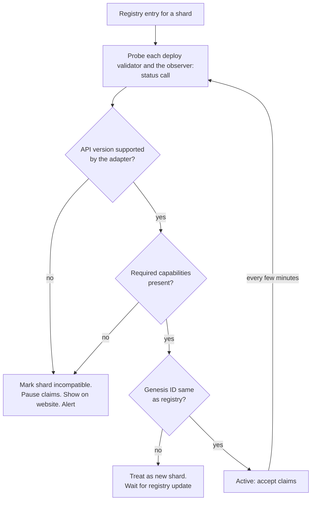

# f1r3node Versioning and Faucet Compatibility

This record proposes a versioning standard for f1r3node-rust and a compatibility mechanism for F1r3Faucet. The faucet must keep working while shards run several node releases, while new shards start after incompatible releases, and while new consensus models arrive.

Status: **proposed**. Section 3 must go to f1r3node-rust as a change to `docs/release-process.md`. Section 4 is F1r3Faucet work (EPIC-012).

## 1. Current state

The frontmatter pins the sources. f1r3node-rust has these parts today:

| Part | Where | State |
|------|-------|-------|
| Release version | Release process, Section 4 | `vMAJOR.MINOR.PATCH` for stable releases, `-canary.N` and `-canary.TRAIN.N` for candidates. Stable versions must increase by Semantic Versioning (invariant 15). The current version is `0.4.46` |
| Rules for a major or minor increase | Release process, Section 5 | Not defined. Automation prepares the next patch. A maintainer can choose a minor or major increase |
| Client API version | `/api/status` and gRPC `status`, field `version.api` | Fixed to the string `"1"` in the code. No rule says when it changes |
| Node version string | `/api/status`, field `version.node` | The build version |
| gRPC package | `casper.v1` | Versioned package name. No `v2` exists |
| HTTP routes | `/api/...` | No version in the path |
| Shard compatibility | Test net design, Section 6 | Proposed: a release declares `requires_fresh_genesis` and `storage_format_changed` in its candidate evidence |
| Consensus model | Candidate evidence | Optional `consensus_model` field. Absent means `cbc-casper` |
| System contract names | `Registry.rho` | A rename removed the older names without an alias (design question Q16) |

The result: a client such as the faucet cannot tell from a node whether the node still accepts its deploys and answers its queries. The vault URI rename showed the effect: two wallets of record stopped working without a version signal.

## 2. Compatibility surfaces

A client depends on four separate surfaces. Each needs its own signal, because they change for different reasons.

| Surface | Examples | Who is affected by a change |
|---------|----------|-----------------------------|
| Client API | HTTP routes, JSON fields, gRPC messages, status values | Faucet, wallets, explorers |
| Deploy format | Signed `DeployData` fields, signature algorithms, `validAfterBlockNumber` rules | Every client that signs deploys |
| System contracts | Registry URIs such as `rho:vault:system`, method names, return shapes | Every client that builds Rholang terms |
| Shard protocol | Wire format, block format, genesis state, storage format, consensus model | Node operators. Clients see it as a new shard |

## 3. Proposed f1r3node-rust versioning standard

### 3.1 Release version

Keep the format of Section 4 of the release process. Add these rules for the increase:

| Change | Before 1.0.0 | From 1.0.0 |
|--------|--------------|------------|
| Breaking change to the client API, the deploy format, or a system contract | MINOR | MAJOR |
| `requires_fresh_genesis: true` (wire, block, or genesis change) | MINOR | MAJOR |
| Additive API change, new optional field, new system contract | PATCH | MINOR |
| Fix with no interface change | PATCH | PATCH |

`storage_format_changed: true` alone does not need a MINOR or MAJOR increase, because clients do not see it.

### 3.2 Client API version

1. `version.api` becomes an integer that increases only for a breaking change to the client API or the deploy format.
2. Additive changes do not change `version.api`. They add a capability (Section 3.3).
3. When `version.api` increases, the node serves the previous API version for at least one MINOR release (before 1.0.0) or one MAJOR release (from 1.0.0). HTTP routes then gain a version prefix (`/api/v2/...`), and gRPC uses a new package (`casper.v2`).
4. The status response lists every API version that the node serves, for example `version.apiSupported: [1, 2]`.

### 3.3 Capabilities

The status response gains a `capabilities` list of stable names, for example:

- `deploy.expirationTimestamp`, `deploy.parameters`
- `query.balance`, `query.deployFinalizationStatus`
- `vault.system`, `vault.alias.rchain` (the older `rho:rchain:*` names resolve)
- `consensus.cbc-casper`, and later `api.neutral` (EPIC-025 TASK-025-5)

A client checks a capability before it uses an optional feature. A capability that a node removes needs the same notice as a breaking change.

### 3.4 System contract names

1. A system contract URI never disappears in a PATCH release.
2. A renamed URI keeps its old name as an alias for at least one MINOR release (before 1.0.0) or one MAJOR release (from 1.0.0).
3. The status response or the capabilities list shows which aliases a node registers.

### 3.5 Shard identity

1. The status response gains `consensusModel` and a `genesisId` (the genesis block hash).
2. The shard registry of the test net (test net design, Section 12.4) publishes these items for each shard: shard ID, consensus model, genesis ID, Anchor releases, and status.
3. A client treats a new genesis ID as a new shard, even when the shard ID is the same.

## 4. Faucet compatibility mechanism

1. **Supported ranges.** Each adapter declares the API versions and the node release range that it supports, for example `cbc-casper: api 1, node >=0.4.46 <0.6.0`. These values live in the adapter source, so a faucet release states them.
2. **Probe.** The faucet calls the status endpoint of each deploy validator and the observer at start and every few minutes. It compares the result with the adapter ranges and the required capabilities.
3. **Lowest common version.** In a mixed-release shard, the faucet uses only the features that every deploy validator supports. It sends deploys only to the Anchors (stack record, Section 6.1), so the Anchor releases set this level.
4. **Fail closed.** An incompatible or unknown shard accepts no claims. The website shows the reason, and an alert fires. The faucet never guesses.
5. **Contract tests by release.** CI runs the adapter contract tests against the latest stable release and the newest canary. A nightly job runs them against each new test net candidate. A failure there warns before the candidate reaches a shard.
6. **Overlap window.** When the node increases `version.api`, the faucet ships an adapter that supports both versions before the old version leaves the test net.
7. **Compatibility matrix.** The faucet documentation shows which faucet release supports which node releases and which shards.
8. **Faucet versions.** F1r3Faucet uses Semantic Versioning for its own releases. Removal of support for a node API version is a breaking faucet change.

### 4.1 Until f1r3node-rust adopts Section 3

The faucet uses `version.node` (a SemVer string) and the adapter's node release range. It treats a missing capability list as "base capabilities of the release range". This fallback is weaker, because a node can change an interface without a signal. Section 3 removes that risk.

## 5. Decisions

| ID | Decision | Owner |
|----|----------|-------|
| V1 | Adopt Section 3 in f1r3node-rust `docs/release-process.md` | f1r3node-rust maintainers |
| V2 | Rule for a MINOR versus a PATCH increase before 1.0.0 (Section 3.1) | f1r3node-rust maintainers |
| V3 | Duration of the overlap window for an old API version and for a contract alias | f1r3node-rust maintainers |
| V4 | Capability names (Section 3.3) | f1r3node-rust and F1r3Faucet maintainers |
| V5 | Release ranges that each faucet adapter supports at launch | F1r3Faucet maintainer |
