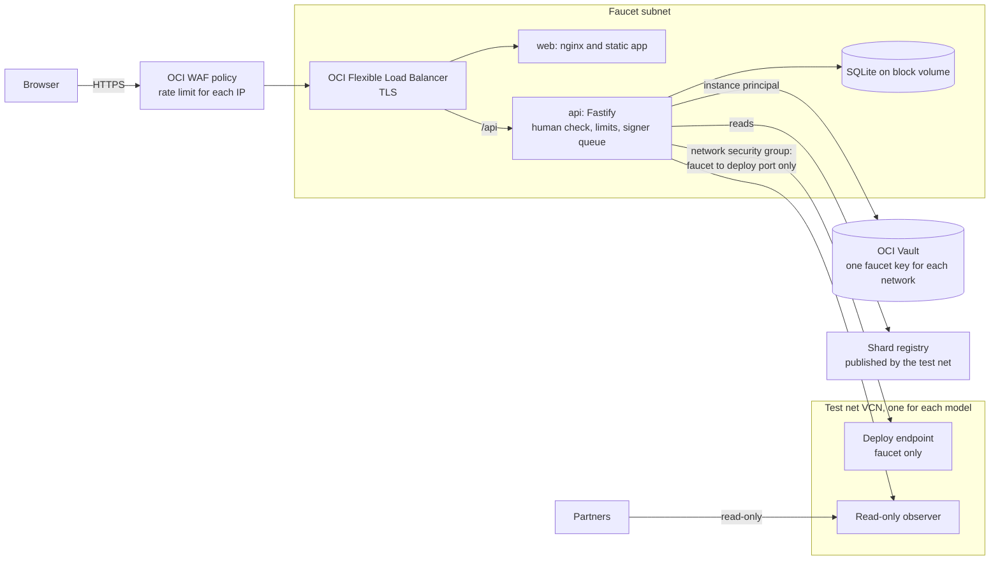

# Stack and Hosting on OCI

This record proposes the web and API stack of F1r3Faucet and its hosting on Oracle Cloud Infrastructure (OCI). It answers design questions Q7, Q8, Q9, and Q14 of the [architecture record](faucet-architecture.md).

Status: **accepted** on 2026-10-15 (decisions S1, S2, and S3). Decisions S4 and S5 in Section 6 remain open.

## 1. Constraints

- The faucet runs on OCI beside each test net (test net design, Section 12.4).
- The faucet API signs deploys with a faucet key from OCI Vault and sends them to a deploy endpoint that only the faucet can reach. Partners reach only the read-only observer (test net design, Sections 10 and 12.4).
- The test net uses Compute VMs with Docker Compose, images in OCI Registry (OCIR), and deployment over SSH (`scripts/remote/deploy.sh` in f1r3node-rust).
- The ASI faucet runs on AWS (ECR, EC2 through SSM, CodeBuild) and uses the AWS WAF captcha. These parts do not move to OCI.

## 2. Options

| Option | Summary | Result |
|--------|---------|--------|
| (a) Vite single-page app and a separate Node API | Two containers. nginx serves the static app. The API holds the key | **Recommended** |
| (b) Next.js, self-hosted | One container with server rendering | Rejected: no need for server rendering, and the signer shares a process with the public render surface |
| (c) Static app in Object Storage, API in the VCN | Static hosting plus API Gateway | Rejected for now: more OCI parts, no team precedent |
| (d) One Node container for the app and the API | Simplest deployment | Rejected: the public static server and the signer share a process |

A faucet is one form and a list of networks. It has no content that needs server rendering for search engines. Static `<title>` and Open Graph tags in `index.html` are sufficient.

No F1r3fly or ASI web application uses Next.js. The F1r3fly applications use Vite with an nginx container (embers-frontend), and the ASI faucet and ASI wallet serve static builds from nginx.

## 3. Recommended stack

| Layer | Selection | Reason |
|-------|-----------|--------|
| Web | Vite, React, TypeScript, Tailwind CSS. Static build served by nginx | Team convention (embers-frontend, Sankey block explorer) |
| API | Node.js 24 with Fastify | Schema validation, `@fastify/rate-limit`, and log redaction, so the key cannot enter a log line |
| Package manager | pnpm workspace | Convention in embers-frontend, Sankey block explorer, and SatchelSmartWallet |
| Tests | Vitest for units and contracts. Playwright for end-to-end tests | Convention in Sankey block explorer and SatchelSmartWallet |
| Claim store | SQLite on a block volume | One signer for each key needs one writer. A move to PostgreSQL stays possible |
| Human check | Cloudflare Turnstile or hCaptcha, checked on the server | Portable. The AWS WAF captcha of the ASI faucet does not run on OCI |

Hono is an acceptable lighter alternative to Fastify.

## 4. Signing in TypeScript

The API signs deploys in TypeScript. It does not call the Rust `rust-client` library.

- Two wallets of record sign deploys in JavaScript or TypeScript today: f1r3wallet (`src/rnode-sign.js`) and the ASI Chain wallet (`src/utils/crypto.ts`). embers-frontend signs with `@noble/curves`.
- The node accepts deploys through `POST /api/deploy`, so the faucet needs no gRPC client.
- A Rust side process would add a second toolchain to the repository.

Rules for `packages/f1r3fly`:

1. Use `@noble/curves` for secp256k1 and `@noble/hashes` for Blake2b-256 and Keccak-256.
2. Generate the protobuf types from `CasperMessage.proto` at a pinned node commit. Do not write the encoder by hand.
3. The signed bytes omit the `language` field and default values, as the node does. The old JavaScript encoders in the wallets are correct only while `expirationTimestamp` (field 13) and `parameters` (field 14) are not set.
4. CI compares signatures with golden vectors that `rust-client` produces for the same inputs.

The evidence for these rules:

[git@github.com:F1R3FLY-io/f1r3wallet.git](https://github.com/F1R3FLY-io/f1r3wallet)

```yaml cross-reference
reference:
  purpose: evidence
  repository: https://github.com/F1R3FLY-io/f1r3wallet
  checkout: ../../../f1r3wallet
  revision: 881d759f01704403c04c778c409a571e0b10a7d6
  path: src/rnode-sign.js
  url: https://github.com/F1R3FLY-io/f1r3wallet/blob/881d759f01704403c04c778c409a571e0b10a7d6/src/rnode-sign.js
```

[git@github.com:asi-alliance/asi-chain-wallet.git](https://github.com/asi-alliance/asi-chain-wallet)

```yaml cross-reference
reference:
  purpose: evidence
  repository: https://github.com/asi-alliance/asi-chain-wallet
  checkout: ../../../../ASI-chain/asi-chain-wallet
  revision: 750b199c05a6676dfd66925f67a9f2b7d708db6c
  path: src/utils/crypto.ts
  url: https://github.com/asi-alliance/asi-chain-wallet/blob/750b199c05a6676dfd66925f67a9f2b7d708db6c/src/utils/crypto.ts
```

[git@github.com:F1R3FLY-io/embers-frontend.git](https://github.com/F1R3FLY-io/embers-frontend)

```yaml cross-reference
reference:
  purpose: evidence
  repository: https://github.com/F1R3FLY-io/embers-frontend
  checkout: ../../../embers-frontend
  revision: e739cab5fb940087b20107f3ba11a7d6d2cec90d
  path: apps/embers/Dockerfile
  url: https://github.com/F1R3FLY-io/embers-frontend/blob/e739cab5fb940087b20107f3ba11a7d6d2cec90d/apps/embers/Dockerfile
```

[git@github.com:F1R3FLY-io/f1r3node-rust.git](https://github.com/F1R3FLY-io/f1r3node-rust)

```yaml cross-reference
reference:
  purpose: evidence
  repository: https://github.com/F1R3FLY-io/f1r3node-rust
  checkout: ../../../f1r3node-rust
  revision: 1b61300cab891e6e898a9b8423cedfd4c23c2ae8
  path: models/src/main/protobuf/CasperMessage.proto
  url: https://github.com/F1R3FLY-io/f1r3node-rust/blob/1b61300cab891e6e898a9b8423cedfd4c23c2ae8/models/src/main/protobuf/CasperMessage.proto
```

## 5. Hosting topology



- **Compute:** one Compute VM with Docker Compose, as the test net uses. OCI Container Instances are a later option.
- **Images:** amd64 images in OCIR, pinned by digest.
- **Secrets:** a dynamic group and a policy give the faucet VM `read secret-bundles` on its faucet keys only. The API reads each key into memory at start. No key goes into an environment file.
- **Network:** the faucet API reaches the deploy endpoint through a network security group rule that allows only the faucet. The test net has one public subnet today, and its security list opens SSH and the node ports to all addresses (test net design, Section 14). The faucet needs a private subnet or network security groups before launch.

## 6. Decisions for the test net operators

Two decisions change the test net network and its node configuration. The maintainer accepted both recommendations on 2026-10-15. f1r3node-rust PR #654 (the test net tooling, a draft) must carry them, because it owns test net design Sections 10, 13.2, and 14.

### 6.1 S2: Which node receives the faucet deploys

Node facts (f1r3node-rust `dev` at `1b61300`, `casper/src/rust/api/block_api.rs`):

- A deploy stays on the node that receives it. Deploys never gossip to other nodes.
- When a node accepts a deploy, that node tries to propose a block that includes it. Only a bonded validator can propose.
- A read-only observer refuses deploys.

Therefore a deploy reaches a block only when the faucet sends it directly to a validator. A "deploy-enabled observer" that does not validate would keep the deploy until it expires. Test net design Section 13.2, Q3, lists that observer as a candidate. It cannot work while deploys do not gossip.

| Option | What the operators do | Advantages | Disadvantages |
|--------|-----------------------|------------|---------------|
| A. Anchor validators (recommended) | Open the HTTP API port (`40403` band) of the three Anchors to the faucet only, through a network security group rule, with failover between Anchors | No new node, and Anchors run a stable release | The HTTP API of a validator becomes reachable from the faucet subnet |
| B. A dedicated faucet validator | Bond a fifth validator that only the faucet uses | The faucet load is separate from the Anchors | A new bond, a new key, and more cost. It changes the four-validator topology of test net design Section 3 |

Do not send faucet deploys to the soaking slot. That node runs a release candidate that can fail.

### 6.2 S3: Where the faucet runs in the OCI network

Each consensus model has its own test net and its own VCN (test net design, Section 12.2). The test net VCN has one public subnet today, and its security list opens SSH and the node ports to all addresses (test net design, Section 14, blocker 1).

| Option | Network layout | Advantages | Disadvantages |
|--------|----------------|------------|---------------|
| A. Inside the test net VCN (recommended for v0.3.0) | A new private subnet in the CbC Casper test net VCN, behind a load balancer in the public subnet | Simplest route to the Anchors, with no peering | When a second test net starts, the faucet must reach another VCN |
| B. A faucet VCN with peering | One faucet VCN, connected to each test net VCN through a Dynamic Routing Gateway (DRG) | One faucet deployment, one claim store, and one website for every test net | DRG attachments and route rules for each new test net |
| C. One faucet API in each test net VCN | One API inside each test net VCN. One website calls the API of the selected network | No peering | Several APIs and several claim stores to operate |

Recommendation: option A for the CbC Casper test net only. Decide between B and C before the second test net starts (v0.4.0).

### 6.3 Other decisions

| ID | Decision | Status |
|----|----------|--------|
| S1 | Accept this record (Vite and Fastify, pnpm, Vitest and Playwright, TypeScript signing) | **Accepted 2026-10-15** |
| S2 | Node that receives faucet deploys (Section 6.1) | **Accepted 2026-10-15:** option A, the three Anchors, with failover |
| S3 | Faucet network placement (Section 6.2) | **Accepted 2026-10-15:** option A for the CbC Casper test net. Decide B or C before v0.4.0 |
| S4 | Human check provider: Turnstile or hCaptcha. Check whether OCI WAF offers a challenge on load balancer policies | Open, maintainer |
| S5 | Image registry: OCIR or Docker Hub | Open, maintainer |
