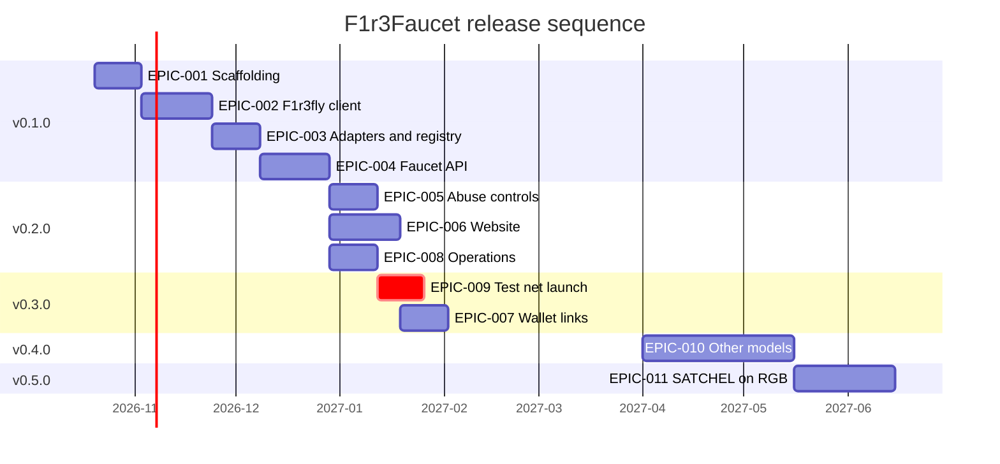

# F1r3Faucet Roadmap

> The Roadmap, Release Date, and Version Normalization Standard in the top-level profile governs this file.
> Update the `updated:` frontmatter field whenever this file is edited.
> Nearest-term releases MAY carry a calendar `target_date` but SHOULD at least reference an implementation sequence; future-quarters entries MAY use the `YYYY-QN` quarter form.

```yaml cross-reference
reference:
  purpose: current
  repository: https://gitlab.com/smart-assets.io/gitlab-profile
  checkout: ../../../SA/top-level-gitlab-profile
  revision: master
  path: docs/common/roadmap-release-normalization-standard.md
  url: https://gitlab.com/smart-assets.io/gitlab-profile/-/blob/master/docs/common/roadmap-release-normalization-standard.md
```

## Current Focus

The architecture is proposed in [designs/faucet-architecture.md](designs/faucet-architecture.md). The stack and hosting on OCI are accepted in [designs/stack-and-hosting.md](designs/stack-and-hosting.md). EPIC-001 can start the work for v0.1.0 now. [ToDos.md](ToDos.md) holds the epics and tasks.



The dates in the chart show sequence and size only. External gates can move v0.3.0 and v0.4.0.

## Upcoming Releases

### v0.1.0 — Local CbC Casper faucet

- **Target:** 2026-Q4
- **Milestone:** _to be created_
- **Status:** planned

A developer can claim tokens from a local f1r3node shard through the API. In: workspace and CI, vault address and deploy signing, the adapter interface, and the network registry. Also in: the `cbc-casper` adapter, and the faucet API with a signer queue and a claim store. Out: website, public deployment. Risk: the signing approach (design question Q9) changes the size of EPIC-002.

### v0.2.0 — Website, abuse controls, and operations

- **Target:** 2027-Q1
- **Milestone:** _to be created_
- **Status:** planned

In: network and claim pages, claim tracker, rate limits, human verification, CORS allowlist, faucet balance floor, metrics, alerts, container images, deployment design. Risk: the human verification provider (Q7) and the public or partner-only decision (Q13).

### v0.3.0 — CbC Casper test net launch and wallet links

- **Target:** 2027-Q1
- **Milestone:** _to be created_
- **Status:** planned

In: the faucet on OCI beside the CbC Casper test net, and a funded faucet wallet in the test net genesis. Also in: the new shard runbook and the partner tier. Also in: the address forms and prefill link for f1r3wallet and the ASI Chain wallet. Gates: the first apply of f1r3node-rust EPIC-014, and TASK-014-10. The deploy endpoint decision in test net design Section 13.2 is also a gate.

### v0.4.0 — Other consensus models

- **Target:** 2027-Q2
- **Milestone:** _to be created_
- **Status:** planned

In: an adapter on the neutral endpoints of f1r3node-rust TASK-025-5, then Cordial Miners, Casanova, and RGB adapters. Gates: TASK-025-5, and a ratified test net design record for each model (TASK-014-9).

### v0.5.0 — SATCHEL on the RGB test net

- **Target:** 2027-Q3
- **Milestone:** _to be created_
- **Status:** planned

In: SATCHEL public key input, the wallet link, and ownership proof on the RGB test net. Gates: the RGB adapter, f1r3node-rust EPIC-025, and design questions Q3 and Q4.

## Out of Scope / Deferred

- Mainnet distribution or token sale — a faucet serves test nets only
- RGB asset issuance from the faucet — waits for design question Q12
- Account login or user profiles — not needed for anonymous claims
- See [Backlog.md](Backlog.md) for other deferred items

## Change Log

| Date | Change |
|------|--------|
| 2026-10-15 | Initial roadmap from the architecture proposal |
| 2026-10-15 | Maintainer answers: wallets of record, OCI hosting, audience. SATCHEL moves to v0.5.0 after the RGB adapter |
| 2026-10-15 | Stack and hosting record accepted. Cosmos address question deferred |
| 2026-10-15 | S2 and S3 accepted. Node compatibility proposal and EPIC-012 added |
